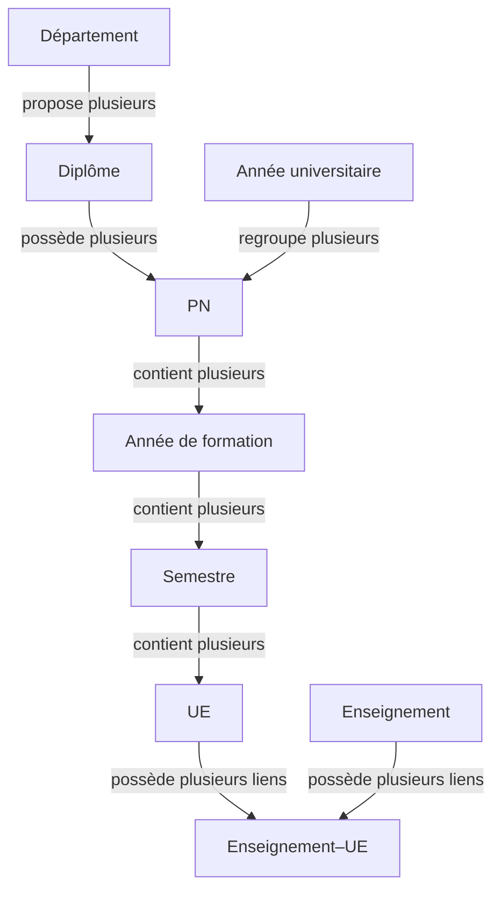

# Structure des formations dans UniServices

Ce document décrit les relations du modèle Doctrine actuel. Les flèches des schémas se lisent du contexte général vers ses éléments ; elles ne représentent pas toutes le sens de stockage des clés étrangères.

## 1. Vue d’ensemble : le PN est le pivot

Une formation se lit suivant deux axes :

- **Organisation** : un département propose des diplômes.
- **Temps** : chaque diplôme possède une maquette pour une année universitaire donnée, représentée par un `StructurePn`.

Le PN relie ces deux axes et contient les années de formation.



Pour remonter depuis une année de formation, le chemin est donc `StructureAnnee → pn → diplome`. L’année universitaire se récupère sur le même PN : `StructureAnnee → pn → anneeUniversitaire`.

## 2. Rôle des entités

| Entité | Rôle | Exemple indicatif |
| --- | --- | --- |
| `StructureDepartement` | Regroupe les diplômes et les affectations des personnels. | Département Informatique |
| `StructureDiplome` | Identifie une formation, éventuellement déclinée par parcours et organisée en diplômes parent/enfants. | BUT Informatique – parcours A |
| `StructureTypeDiplome` | Précise le type du diplôme. | BUT, licence professionnelle |
| `StructureAnneeUniversitaire` | Représente la période universitaire et regroupe les PN correspondants. | 2026–2027 |
| `StructurePn` | Relie un diplôme à une année universitaire et porte sa maquette. | PN du diplôme pour 2026–2027 |
| `StructureAnnee` | Représente une année de formation à l’intérieur du PN. | BUT 1, BUT 2, BUT 3 |
| `StructureSemestre` | Découpe une année de formation en semestres. | S1, S2 |
| `StructureUe` | Porte une unité d’enseignement d’un semestre, ses ECTS et son coefficient. | UE 1.1 |
| `ScolEnseignement` | Décrit un enseignement, notamment une ressource ou une SAÉ. | Une ressource de programmation |
| `ScolEnseignementUe` | Associe un enseignement à une UE, avec des ECTS et un coefficient propres à ce lien. | Contribution d’une ressource à une UE |
| `StructureGroupe` | Représente un groupe pédagogique associé à un ou plusieurs semestres. | Groupe TD 1, groupe TP 1 |

### Deux significations différentes du mot « année »

- `StructureAnneeUniversitaire` est une période, par exemple **2026–2027**. Son champ `annee` est un entier servant notamment à initialiser l’année de publication du PN.
- `StructureAnnee` est un niveau dans la formation, par exemple **BUT 2**, avec un champ `ordre`.

Une année universitaire peut donc contenir de nombreux PN, chacun contenant plusieurs années de formation. Une `StructureAnnee` est rattachée à un PN précis : elle n’est pas un niveau global partagé automatiquement entre tous les PN.

## 3. Diplôme, année universitaire et PN

`StructurePn` possède deux relations `ManyToOne` centrales :

| Propriété du PN | Cible | Collection inverse |
| --- | --- | --- |
| `diplome` | `StructureDiplome` | `StructureDiplome.pns` |
| `anneeUniversitaire` | `StructureAnneeUniversitaire` | `StructureAnneeUniversitaire.pns` |

Une contrainte unique sur `(diplome_id, annee_universitaire_id)` impose **au plus un PN par couple diplôme / année universitaire** lorsque ces références sont renseignées.

Le diplôme peut ainsi rester la même entité d’une année universitaire à l’autre, tandis que ses PN portent les différentes maquettes annuelles. Le champ `anneePublication` du PN est une information descriptive ; la relation `anneeUniversitaire` détermine son rattachement temporel.

### Ouverture d’un diplôme pour une année universitaire

`StructureDiplome` ne possède pas de propriété `actif`. Un diplôme est proposé pour une année universitaire s’il possède un PN rattaché à cette année. Son absence de PN indique qu’il n’est pas proposé cette année-là, sans supprimer le diplôme ni ses données historiques.

Le filtre API `structure_diplomes?anneeUniversitaire=<id>` applique cette règle via les PN. Les écrans annuels doivent fournir l’année sélectionnée ; les écrans de catalogue et de préparation d’une nouvelle année peuvent conserver la liste complète des diplômes pour permettre leur réouverture.

Les propriétés `actif` des départements et années de formation restent distinctes et sont conservées. `StructureSemestre` ne possède plus de propriété `actif` : tous les semestres de la maquette sont disponibles, même si leurs enseignements se chevauchent ou si les inscriptions aux deux semestres sont créées dès le début de l’année.

Les listes de semestres sont limitées par `anneeUniversitaire` via `semestre → annee → pn`. Le contexte Axios transmet l’année sélectionnée ; une opération annuelle sans sélection, année explicite ou parent identifiable est refusée. Le filtre département/diplôme n’impose plus implicitement une année active ; une année passée peut être demandée explicitement. La clôture et la validation des résultats sont indépendantes de cette disponibilité.

### Initialisation d’une année universitaire

`AnneeUnivInitProcessor` utilise la sélection `diplomeIds` pour créer les PN manquants des diplômes sélectionnés :

- `diplomeIds = null` : les PN ne sont pas modifiés ;
- une liste explicite : les PN manquants sont créés et ceux des diplômes retirés sont supprimés ;
- une liste vide : tous les PN de cette année sont retirés.

Cette initialisation crée les PN, sans créer automatiquement leurs années, semestres, UE et enseignements. Les suppressions de PN peuvent entraîner celles des éléments de maquette liés par les cascades Doctrine.

`StructureDiplome.getAnneesUniversitaires()` calcule les années disponibles à partir des PN. Une collection historique `StructureAnneeUniversitaire.legacyDiplomes` subsiste dans le code ; les PN constituent la référence pour comprendre l’association métier entre diplôme et année universitaire.

## 4. Années de formation, semestres, UE et enseignements

| Entité enfant | Propriété vers son parent | Relation |
| --- | --- | --- |
| `StructureAnnee` | `pn` | Plusieurs années pour un PN |
| `StructureSemestre` | `annee` | Plusieurs semestres pour une année de formation |
| `StructureUe` | `semestre` | Plusieurs UE pour un semestre |
| `ScolEnseignementUe` | `ue` | Plusieurs liens d’enseignement pour une UE |
| `ScolEnseignementUe` | `enseignement` | Plusieurs liens vers des UE pour un enseignement |

Un enseignement n’est donc pas simplement l’enfant d’une seule UE : **il peut contribuer à plusieurs UE**, par l’intermédiaire de `ScolEnseignementUe`. Le coefficient et les ECTS du lien permettent de décrire cette contribution dans chaque UE.

`ScolEnseignement` possède également des relations `parent` / `enfants`, un lien `sae` et des liens vers des apprentissages critiques. Ces relations complètent son organisation pédagogique sans remplacer son rattachement aux UE.

### Exemple de lecture

Pour trouver le diplôme et l’année universitaire associés à une UE :

```php
$pn = $ue->getSemestre()?->getAnnee()?->getPn();
$diplome = $pn?->getDiplome();
$anneeUniversitaire = $pn?->getAnneeUniversitaire();
```

Pour un enseignement, il faut parcourir ses liens `enseignementUes` puis remonter depuis chaque UE. Il ne faut pas supposer qu’un enseignement possède un unique semestre ou diplôme sans examiner ces liens.

## 5. Référentiel APC et parcours

Le modèle APC décrit les compétences et les parcours en complément de la maquette.

| Relation | Signification |
| --- | --- |
| `StructureDiplome.referentiel → ApcReferentiel` | Référentiel associé au diplôme |
| `StructurePn.apcReferentiel → ApcReferentiel` | Référentiel associé au PN |
| `StructureDiplome.parcours → ApcParcours` | Parcours associé au diplôme |
| `ApcReferentiel.competences → ApcCompetence` | Compétences du référentiel |
| `ApcNiveau.competence → ApcCompetence` | Compétence à laquelle appartient le niveau |
| `ApcNiveau.annee → StructureAnnee` | Année de formation associée au niveau |
| `ApcNiveau.parcours ↔ ApcParcours` | Parcours concernés par les niveaux, en ManyToMany |
| `ApcApprentissageCritique.niveau → ApcNiveau` | Niveau auquel appartient l’apprentissage critique |
| `StructureUe.competence → ApcCompetence` | Compétence associée à une UE |

`StructureDiplome` et `ApcParcours` sont deux entités distinctes. Le diplôme porte le rattachement au département et les PN ; le parcours porte une identité pédagogique et ses liens vers les niveaux APC. Plusieurs diplômes peuvent référencer le même `ApcParcours` selon le mapping.

Les relations `StructureDiplome.parent` et `enfants` permettent une hiérarchie de diplômes. Cette hiérarchie est distincte de la succession des années de formation et ne remplace pas le lien `diplome.parcours`.

## 6. Groupes et inscriptions étudiantes

Les groupes sont associés aux semestres par une relation **ManyToMany** : un semestre peut avoir plusieurs groupes et un groupe peut être partagé par plusieurs semestres.

Un groupe peut aussi avoir :

- un parent et des enfants, pour organiser une hiérarchie de groupes ;
- un `ApcParcours` via sa propriété `parcours`.

Les inscriptions relient les étudiants à cette structure :

| Entité | Rattachements principaux |
| --- | --- |
| `EtudiantScolarite` | Étudiant, année universitaire, département et inscriptions semestrielles |
| `EtudiantScolariteSemestre` | Scolarité, semestre suivi et groupes |

Le diplôme suivi se retrouve en remontant depuis le semestre : `semestre → annee → pn → diplome`. Les propriétés `proposition` des scolarités et inscriptions semestrielles représentent des propositions de poursuite ; elles sont distinctes du semestre effectivement suivi.

## 7. Personnels et responsabilités

Le responsable de diplôme est référencé directement par `StructureDiplome.responsableDiplome`. L’assistant est référencé par `assistantDiplome`.

Le responsable de parcours est configuré sur **l’affectation départementale** `StructureDepartementPersonnel` :

- `personnel` identifie la personne ;
- `departement` définit le contexte de l’affectation ;
- `permissions` contient `ROLE_RESP_PARCOURS` ;
- `responsableParcoursDiplomes` sélectionne les diplômes concernés par une relation ManyToMany.

Les diplômes sélectionnés doivent appartenir au département de l’affectation. Les permissions de responsable de parcours sont vérifiées dans le périmètre du diplôme concerné, avec le package `intranet` activé. Le rattachement se fait donc aux `StructureDiplome`, et non directement aux `ApcParcours`.

`Personnel` ne possède plus de relation directe avec `StructureAnneeUniversitaire`. Les activités annuelles possèdent leurs propres rattachements : notamment `Previsionnel.anneeUniversitaire` pour les enseignements attribués et `PersonnelEnseignantHrs.annee_universitaire` pour les heures complémentaires.

## 8. Exemple complet

Pour le diplôme fictif « BUT Informatique – parcours A » du département Informatique :

| Élément | Instance illustrative |
| --- | --- |
| Diplôme | BUT Informatique – parcours A |
| Année universitaire | 2026–2027 |
| PN | Maquette de ce diplôme pour 2026–2027 |
| Année de formation du PN | BUT 2 |
| Semestre de cette année | S3 |
| UE de ce semestre | UE 3.1 |
| Enseignement associé par `ScolEnseignementUe` | Ressource de programmation |
| Groupe associé au semestre | TD 1 |

Pour 2027–2028, le même diplôme peut avoir un autre PN, avec ses propres années de formation, semestres et UE. Une responsabilité de parcours reste liée au diplôme sélectionné ; elle n’est pas portée par un PN annuel.

## 9. Sources dans le dépôt

- [Entités de structure](../back/src/Entity/Structure/)
- [Entités APC](../back/src/Entity/Apc/)
- [Enseignement](../back/src/Entity/Scolarite/ScolEnseignement.php) et [association enseignement–UE](../back/src/Entity/Scolarite/ScolEnseignementUe.php)
- [Scolarité annuelle](../back/src/Entity/Etudiant/EtudiantScolarite.php) et [inscription semestrielle](../back/src/Entity/Etudiant/EtudiantScolariteSemestre.php)
- [Initialisation d’une année universitaire](../back/src/State/Processor/AnneeUniv/AnneeUnivInitProcessor.php)
- [Résolution des permissions départementales et par diplôme](../back/src/Security/PermissionResolver.php)

## Calendrier universitaire

Le calendrier se calcule depuis `StructureAnneeUniversitaire.dateDebutSemaineFormation`, jusqu’au 31 août N+1 inclus. Les vacances ne suspendent pas le compteur. Les semaines ne sont plus stockées dans une entité dédiée. Voir [le fonctionnement et la reprise historique](CALENDRIER_UNIVERSITAIRE.md).

La résolution automatique du contexte et les exceptions sont décrites dans [Gestion des années universitaires](ANNEES_UNIVERSITAIRES.md).
