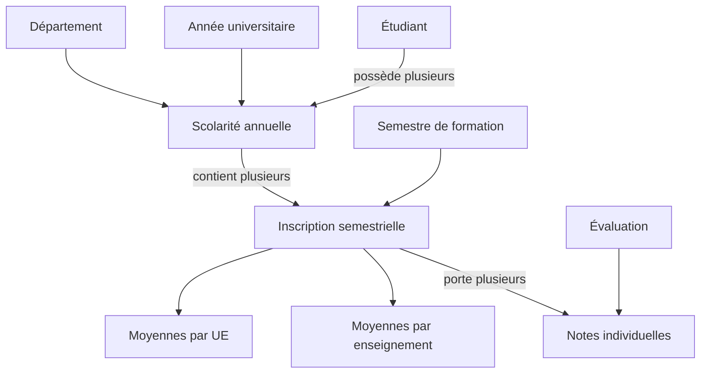

# Structure de la scolarité dans UniServices

Ce document décrit les inscriptions, les notes et le cycle de validation des résultats dans UniServices. Les règles de décision présentées sont celles de l’application.

## 1. Vue d’ensemble

`Etudiant` porte l’identité de la personne. `EtudiantScolarite` représente son dossier pour une année universitaire et un département. `EtudiantScolariteSemestre` décrit chacun des semestres suivis dans ce dossier.



Les groupes et absences sont également rattachés à l’inscription semestrielle. Le schéma représente les relations métier ; il ne représente pas le sens de stockage des clés étrangères.

## 2. Le dossier annuel : `EtudiantScolarite`

| Propriété | Rôle dans le modèle |
| --- | --- |
| `etudiant` | Identité de l’étudiant concerné |
| `anneeUniversitaire` | Période universitaire, par exemple 2026–2027 |
| `departement` | Département de rattachement du dossier |
| `scolariteSemestre` | Collection des inscriptions semestrielles |
| `ordre` | Information d’ordre stockée sur le dossier |
| `actif` | État actif du dossier, distinct de l’année universitaire active |
| `public` | Indicateur de publication stocké sur le dossier |
| `moyenne` | Résultat global annuel éventuellement enregistré |
| `nbAbsences` | Compteur d’absences stocké au niveau annuel |
| `decision` | Décision annuelle nullable, sous forme de booléen |
| `proposition` | Année de formation proposée pour la poursuite, via `StructureAnnee` |
| `commentaire` | Commentaire du dossier |
| `packages` | Applications accessibles dans ce contexte |

Le dossier annuel n’a pas de relation directe vers un diplôme ou une année de formation suivie. Ces informations se retrouvent en parcourant les inscriptions semestrielles.

`getAnnee()` renvoie une **liste calculée d’années de formation distinctes** depuis les semestres suivis. Ce n’est pas une colonne en base, et ce n’est pas la propriété `anneeUniversitaire`.

## 3. L’inscription semestrielle : `EtudiantScolariteSemestre`

Cette entité relie le dossier annuel à un `StructureSemestre` précis de la maquette.

| Propriété | Rôle dans le modèle |
| --- | --- |
| `scolarite` | Dossier annuel parent |
| `semestre` | Semestre effectivement suivi |
| `groupes` | Groupes de l’étudiant pour cette inscription, en ManyToMany |
| `note` | Collection des notes rattachées à cette inscription |
| `absence` | Collection des absences rattachées à cette inscription |
| `moyenne` | Moyenne générale semestrielle éventuellement enregistrée |
| `rang` | Champ de rang stocké dans l’entité |
| `decision` | Décision semestrielle nullable, sous forme de booléen |
| `nbAbsences` | Compteur d’absences stocké pour le semestre |
| `proposition` | Semestre proposé pour la poursuite, distinct du semestre suivi |
| `legacyContext` | Informations de contexte historique issues de V3 |

Le chemin vers la structure de formation est :

```php
$scolarite = $inscription->getScolarite();
$anneeUniversitaire = $scolarite?->getAnneeUniversitaire();
$etudiant = $scolarite?->getEtudiant();

$pn = $inscription->getSemestre()?->getAnnee()?->getPn();
$diplome = $pn?->getDiplome();
```

L’année universitaire du dossier et celle du PN doivent être cohérentes. L’existence de ces relations ne signifie pas, à elle seule, qu’une contrainte de cohérence croisée est appliquée automatiquement par Doctrine.

Pour les groupes, `SynchroSemestrePreviousProcessor` permet une reprise depuis le semestre précédent de la même année de formation. Il rapproche les étudiants et les groupes selon leur type et leur ordre ; ce traitement ne constitue pas une validation de passage au semestre suivant.

## 4. Évaluations et notes

### Une évaluation, plusieurs résultats individuels

`ScolEvaluation` décrit une épreuve : enseignement, semestre, année universitaire, coefficient `coeff`, date, type d’évaluation, type de groupe, personnels autorisés, visibilité, état et statistiques.

`EtudiantNote` représente le résultat individuel à cette évaluation. Elle référence :

- `evaluation` : l’épreuve concernée ;
- `scolariteSemestre` : l’inscription semestrielle concernée ;
- `scolarite` : un rattachement direct supplémentaire au dossier annuel.

Le lien `scolariteSemestre` est nullable dans le mapping actuel. Il ne faut donc pas supposer que toutes les notes historiques permettent de remonter à un semestre. Le lien direct `scolarite` existe en parallèle : la cohérence des deux rattachements doit être préservée par les traitements d’écriture.

La note contient aussi un commentaire, un statut de présence, un historique, un indicateur `publiee`, des dates techniques et un UUID. Le dossier annuel `public`, l’évaluation `visible` et la note `publiee` sont des indicateurs distincts ; ils ne doivent pas être confondus.

### Statuts de présence

Le résultat de `EtudiantNote.getNote()` dépend du statut :

| `presenceStatut` | Valeur renvoyée par `getNote()` |
| --- | --- |
| `present` | Valeur numérique stockée, éventuellement `null` |
| `absent_justifie` | Sentinelle `-0.01` |
| `dispense` | Sentinelle `-0.01` |
| `absent_injustifie` | `0.0` |

Ces valeurs décrivent le comportement du getter. Elles ne définissent pas à elles seules une politique complète de calcul des moyennes. Le setter accepte actuellement l’intervalle `[-0.01, 20]`, bien que son message d’erreur mentionne 0 à 20.

### Ce qui se passe lors d’une saisie

Les opérations de création et de modification des notes utilisent `EtudiantNotePersistProcessor` :

1. Persistance de la note.
2. Réévaluation de l’état de l’évaluation, sauf maintien d’un état manuel.
3. Mise à jour des statistiques de cette évaluation.

Les statistiques comprennent moyenne, médiane, minimum, maximum et nombres d’absences justifiées, injustifiées et de dispenses. Les trois statuts d’absence/dispense sont exclus des valeurs numériques de ces statistiques, y compris l’absence injustifiée pour laquelle le getter renvoie 0. Lorsqu’aucune valeur n’est retenue, les statistiques numériques sont enregistrées à 0.

**Ce processor ne recalcule pas les moyennes par enseignement, par UE, semestrielles ou annuelles.** Les statistiques d’une évaluation et les moyennes de scolarité sont deux niveaux différents.

### Rattrapages

`ScolEvaluationRattrapage` relie une évaluation à un étudiant, avec personnel, salle, date, horaires et état. Cette entité organise le rattrapage ; elle ne porte pas une note de remplacement dédiée et ne définit pas à elle seule la règle de substitution du résultat.

## 5. Où sont stockées les moyennes ?

| Niveau | Stockage | Rattachement |
| --- | --- | --- |
| Évaluation | `ScolEvaluation.stats` | Statistiques collectives des notes de l’épreuve |
| Enseignement et UE | `ResultatSousCommission.resultat` | Inscription semestrielle et révision validée |
| Semestre | `EtudiantScolariteSemestre.moyenne` | Moyenne de la révision validée courante |
| Année universitaire | `EtudiantScolarite.moyenne` | Dossier annuel |
| Historique V3 | `EtudiantScolariteSemestre.legacyContext` | Moyenne semestrielle, moyennes de matières et d’UE importées |

`MoyennesCalculator` calcule la moyenne d’un enseignement à partir des notes pondérées par les coefficients des évaluations. L’absence injustifiée compte pour zéro. L’absence justifiée et la dispense sont exclues du calcul. Une note obligatoire manquante bloque la validation.

La moyenne d’UE pondère les moyennes d’enseignement par les coefficients de leurs liens `ScolEnseignementUe`. Un enseignement peut contribuer à plusieurs UE. La sous-commission calcule les moyennes au niveau du semestre.

Les entités historiques `MoyenneEnseignement` et `MoyenneUe` conservent les anciennes lignes, avec leur personnel associé. Leur accesseur `getEtudiantScolariteSemestre()` renvoie l’inscription semestrielle.

## 6. Calcul et validation en sous-commission

La page `SousCommissionView.vue` charge les semestres de l’année de formation sélectionnée, puis appelle :

```text
GET /api/intranet/commissions/semestre/{semestreId}
```

L’accès exige un utilisateur authentifié et soit `CAN_EDIT_SEMESTRE` sur le semestre, soit `ROLE_SCOLARITE` dans son département.

### Chaîne de traitement

| Composant | Responsabilité |
| --- | --- |
| `CommissionController` | Résout le semestre, vérifie les droits et renvoie le JSON |
| `SousCommissionService` | Consulte le calcul courant ou la révision validée et gère le cycle de validation |
| `CommissionService` | Calcule la vue à partir du jeu de données et de la stratégie |
| `CommissionDataLoader` | Charge les inscriptions, la maquette, les évaluations et les notes, puis appelle le calculateur |
| `CommissionStrategyResolver` | Choisit le mode selon le caractère APC du type de diplôme |
| `ClassiqueCommissionStrategy` / `ApcCommissionStrategy` | Construisent les colonnes et lignes de résultat |
| `ClassiqueDecisionRule` / `ApcDecisionRule` | Produisent une décision indicative et son libellé |
| `CommissionView`, `CommissionRow`, `CommissionColumn` | DTO de sortie ; ce ne sont pas des entités persistées |

Le calculateur indexe les moyennes sous la forme `[inscriptionSemestrielleId][ueId]` ou `[inscriptionSemestrielleId][enseignementId]`. Le chargement des inscriptions est effectué sur le semestre demandé, sans filtre supplémentaire sur `EtudiantScolarite.actif`.

### Moyenne générale affichée

Pour une sous-commission ouverte, la moyenne générale est pondérée à partir des moyennes d’UE actives :

```text
moyenne générale = somme(moyenne UE × poids UE) / somme(poids UE retenus)
```

| Mode | Poids utilisé |
| --- | --- |
| Classique | `StructureUe.coefficient` |
| APC | `StructureUe.nbEcts` |

La moyenne est arrondie à trois décimales. Elle est indisponible si une UE active de poids positif n’a pas de moyenne ou si la somme des poids est nulle.

### Décisions actuellement codées

| Mode | Conditions et libellés |
| --- | --- |
| Classique | Moyenne générale absente : « Incomplet ». Sinon validation à partir de 10/20. Les UE à au moins 10 sont comptées à titre informatif. |
| APC | Une moyenne d’UE manque ou aucune UE n’est disponible : « Incomplet ». Toutes les UE à au moins 10 : « Semestre validé ». Sinon moyenne générale à au moins 10 et aucune UE sous 8 : « Validé par compensation ». Sinon « Non validé ». |

La règle APC est explicitement présentée dans le code comme **indicative et à adapter au règlement local**. Le mode classique se fonde sur la moyenne générale disponible.

### Rangs, statistiques et restitution

Le rang affiché est recalculé sur les lignes ayant une moyenne, par ordre décroissant. Les ex æquo partagent le rang : par exemple 1, 1, 3. La validation recopie le rang dans l’inscription semestrielle.

La vue fournit effectif, moyenne de promotion, minimum, maximum, nombre de validations et taux de réussite. Le taux utilise toutes les lignes comme dénominateur, y compris celles dont la décision est indéterminée. Les lignes sont ensuite triées par nom et prénom.

L’interface propose des tableaux classiques ou APC, une présentation par UE ou par enseignement en APC, des filtres et un export CSV.

La consultation d’une sous-commission ouverte calcule la vue. La validation crée une révision avec un résultat par inscription et recopie la moyenne, le rang et la décision du jury sur chaque inscription. Une sous-commission validée affiche la révision enregistrée. La réouverture conserve cette révision dans l’historique et efface les résultats courants de l’inscription. La restauration crée une nouvelle révision à partir des résultats d’une révision antérieure.

## 7. Décision enregistrée et proposition de poursuite

| Niveau | Décision stockée | Proposition stockée |
| --- | --- | --- |
| Dossier annuel | `EtudiantScolarite.decision` | `StructureAnnee` |
| Inscription semestrielle | `EtudiantScolariteSemestre.decision` | `StructureSemestre` |
| Vue de commission | Décision calculée dans `CommissionRow` | Pas de proposition générée dans ce traitement |

Une décision stockée est un booléen nullable ; elle ne porte pas tout le détail d’une délibération. La proposition de décision affichée pendant la préparation est calculée. La révision validée conserve la proposition calculée, la décision du jury et le motif d’une éventuelle dérogation.

Une proposition désigne une destination envisagée. La renseigner ne crée pas automatiquement un nouveau dossier annuel ou une inscription au semestre proposé.

## 8. Absences et historique

`EtudiantAbsence` se rattache à l’inscription semestrielle et peut référencer un événement EDT. Les compteurs `nbAbsences` annuels et semestriels sont des valeurs stockées : leur existence ne garantit pas une actualisation automatique à chaque absence.

L’historique se lit en partant des dossiers annuels de l’étudiant, puis de leurs inscriptions et des semestres de leurs PN. `legacyContext` et les rattachements directs conservés sur les notes permettent de représenter des situations issues de V3 qui ne correspondent pas toujours à une maquette native complète.

## 9. Reprise V3 et publication

- `ScolariteDetailsMigrator` importe le rang, les moyennes par matière et par UE et la décision V3 dans `legacyContext.resultatsV3`. Il conserve le code de décision d’origine avec sa traduction en booléen nullable. Relancer la migration de base préserve ces détails.
- Les moyennes courantes sont calculées à partir des notes. Les révisions imposent en base un résultat unique par couple révision/inscription. Les anciennes lignes de moyennes restent disponibles pour l’historique.
- La validation, la réouverture et la restauration pilotent les résultats semestriels. La publication du dossier annuel et des notes relève de leurs indicateurs respectifs. La consultation est une lecture.

## 10. Sources dans le dépôt

- [Dossier annuel](../back/src/Entity/Etudiant/EtudiantScolarite.php) et [inscription semestrielle](../back/src/Entity/Etudiant/EtudiantScolariteSemestre.php)
- [Notes](../back/src/Entity/Etudiant/EtudiantNote.php), [évaluations](../back/src/Entity/Scolarite/ScolEvaluation.php) et [rattrapages](../back/src/Entity/Scolarite/ScolEvaluationRattrapage.php)
- [Processor de saisie des notes](../back/src/State/Processor/Evaluation/EtudiantNotePersistProcessor.php)
- [Moyennes d’UE](../packages/intranet-bundle/src/Entity/Etudiant/MoyenneUe.php) et [moyennes d’enseignement](../packages/intranet-bundle/src/Entity/Etudiant/MoyenneEnseignement.php)
- [Services, stratégies, règles et DTO de commission](../packages/intranet-bundle/src/Commission/)
- [Contrôleur de commission](../packages/intranet-bundle/src/Controller/CommissionController.php) et [page de sous-commission](../packages/intranet-bundle/assets/views/Administration/SousCommission/SousCommissionView.vue)
- [Migration des détails V3](../back/src/Migration/IntranetV3/Scolarite/ScolariteDetailsMigrator.php)
- [Structure de formation](STRUCTURE_FORMATION.md)

## Disponibilité des semestres

`StructureSemestre.actif` est supprimé. Une inscription peut exister sur chacun des deux semestres dès le début de l’année ; les cours peuvent se chevaucher. Les listes utilisent le PN de l’année universitaire sélectionnée, sans distinguer un semestre « actif ». La sélection du semestre de travail et la validation des résultats restent des notions distinctes.

La résolution automatique du contexte et les exceptions sont décrites dans [Gestion des années universitaires](ANNEES_UNIVERSITAIRES.md).
